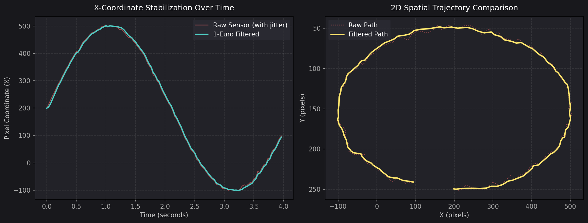

# Air Canvas (Python + OpenCV)

Air Canvas is a responsive, touchless computer vision application that lets you sketch, write, and draw in mid-air using your webcam, OpenCV, and MediaPipe. By combining an ergonomic pinch-to-draw gesture with an adaptive 1-Euro point filter and quadratic Bézier curve interpolation, it delivers fluid digital calligraphy without hand fatigue or jerky strokes.

---

## 🎬 Demo


> **Note**: Record a brief demonstration of mid-air writing with the application and save the animation as `docs/demo.gif` to display it here.

---

## 🌟 Ergonomics & Calligraphy Features

### 1. No More Hand Fatigue or "Restlessness"
In traditional air canvas apps, holding only your index finger up while curling the other three fingers creates severe muscle strain and tremors within 30 seconds.

We solved this with **Ergonomic Pinch-to-Draw**:
* Hold your hand in a completely natural, relaxed pen grip.
* **Pinch your thumb and index fingertips together**: **PEN DOWN (Draws)**!
* **Separate them slightly**: **PEN UP (Hovers)**!
* Your other fingers remain fully relaxed—no clenching, zero fatigue.
* Physical contact between thumb and index gives you real tactile biofeedback and stabilizes your coordinates.
* **Scale-Invariant Hysteresis**: Uses distinct start (0.18) and stop (0.28) thresholds relative to hand size to prevent flickering at the pinch boundary.

### 2. Smooth Calligraphy with Double Filtering
* **Adaptive 1-Euro Filter**: Uses the 1-Euro filter algorithm to eliminate hand micro-tremors and sensor noise at low speeds while maintaining low-latency responsiveness during swift strokes.
* **Midpoint Quadratic Bézier Spline Curves**: Instead of jagged polygonal lines between webcam frames, strokes are mathematically interpolated using smooth quadratic Bézier curves.
* **Micro-jitter Gate**: Automatically ignores movements under 2.5 pixels to prevent ink blotches when holding still.



---

## 🎮 Input & Background Modes

### Input Modes (Switch with <kbd>G</kbd> or Toolbar)
1. 🤏 **Pinch-to-Draw** *(Default)*: Natural pen grip; pinch thumb & index together to write.
2. 🖊️ **Physical Marker / Stylus Mode**: Hold any real colored marker, pen cap, or stylus. Hover is active by default so you can navigate and use toolbar buttons. Press <kbd>Space</kbd> or <kbd>D</kbd> to toggle drawing on and off. Press <kbd>T</kbd> to calibrate any color.
3. ⌨️ **Key Hold Mode**: Relax your hand completely and move the cursor; tap or hold <kbd>Space</kbd> or <kbd>D</kbd> to lay down ink.
4. ☝️ **Index Finger Mode**: Legacy pointing mode (pointing finger writes, two fingers hover/select).

### Background Modes (Switch with <kbd>B</kbd>)
* **Blackboard**: Dark background with vibrant neon glow effect.
* **Webcam AR Overlay**: Live mirrored camera feed with drawing composited on top.
* **Whiteboard**: Clean white drawing background with dark ink.

---

## ⌨️ Controls & Shortcuts

| Input | Action | Description |
| :---: | :--- | :--- |
| 🤏 **Pinch** | **Draw (Pen Down)** | Touch thumb & index tips to write (Pinch mode) |
| ✌️ **Hover** | **Move / Select** | Move cursor; dwell 350ms over top toolbar buttons to trigger |
| <kbd>Space</kbd> | **Toggle Pen / Clear** | Toggles pen in Key Hold & Marker modes; clears canvas in Pinch & Index modes |
| <kbd>D</kbd> | **Pen Toggle** | Toggles pen down / pen up in Key Hold and Marker modes |
| <kbd>U</kbd> | **Undo** | Remove the last stroke drawn |
| <kbd>C</kbd> / <kbd>1</kbd>–<kbd>6</kbd> | **Colors** | Ice Cyan, Neon Green, Hot Pink, Amber Gold, Orange Red, Pure White |
| <kbd>E</kbd> | **Eraser** | Toggle eraser mode |
| <kbd>+</kbd> / <kbd>-</kbd> | **Thickness** | Increase / decrease brush or eraser size |
| <kbd>B</kbd> | **Background** | Cycle: Blackboard $\rightarrow$ Webcam AR $\rightarrow$ Whiteboard |
| <kbd>G</kbd> | **Cycle Input Mode** | Pinch-to-Draw $\leftrightarrow$ Physical Marker $\leftrightarrow$ Key Mode $\leftrightarrow$ Index Finger |
| <kbd>T</kbd> | **Marker Calibrate** | Place marker tip in center box and press T to calibrate color |
| <kbd>R</kbd> | **Record Video** | Start / stop recording session to `.avi` video |
| <kbd>S</kbd> | **Save Image** | Save high-resolution PNG snapshot to project folder |
| <kbd>F</kbd> | **Fullscreen** | Toggle fullscreen display |
| <kbd>H</kbd> | **HUD Toggle** | Show / hide toolbar and status overlays |
| <kbd>Q</kbd> / <kbd>Esc</kbd> | **Quit** | Exit cleanly |

---

## 🚀 Setup & Installation

### 1. Prerequisites
* Python 3.9+ (tested on Python 3.11 on Windows)
* A functioning webcam

### 2. Create and Activate Virtual Environment

**Windows (PowerShell):**
```powershell
python -m venv venv
.\venv\Scripts\activate
```

**macOS / Linux:**
```bash
python3 -m venv venv
source venv/bin/activate
```

### 3. Install Dependencies
```bash
pip install -r requirements.txt
```

For development (testing, plotting):
```bash
pip install -r requirements-dev.txt
```

---

## 💻 How to Run

### Windows Quick Launcher
Double-click `run.bat` or run:
```powershell
.\run.bat
```

### Command Line
```powershell
python main.py
```
*(On macOS/Linux, use `python3 main.py`)*

### CLI Options
```text
options:
  -h, --help       show this help message and exit
  --camera CAMERA  Webcam device index (default: 0)
  --width WIDTH    Camera capture width (default: 1280)
  --height HEIGHT  Camera capture height (default: 720)
  --video VIDEO    Optional path to a video file to play instead of webcam stream
```

Example running on a secondary webcam at 1080p:
```powershell
python main.py --camera 1 --width 1920 --height 1080
```

---

## 🧪 Testing

The test suite is split between fast, camera-free unit tests and opt-in hardware integration tests.

### Run Unit Tests (No Camera Needed)
```bash
pytest
```
This tests the 1-Euro filter, 2D coordinate filter, Bézier curve interpolation, and pinch hysteresis logic.

### Run Camera Integration Tests
To test full application lifecycle with a connected webcam:

**Windows (PowerShell):**
```powershell
$env:RUN_CAMERA_TESTS="1"; pytest; Remove-Item Env:\RUN_CAMERA_TESTS
```

**Linux / macOS:**
```bash
RUN_CAMERA_TESTS=1 pytest
```

---

## 📊 Generating Jitter Comparison Plots

To generate the 1-Euro stabilization comparison plot:
```bash
python scripts/plot_jitter.py --output docs/jitter_comparison.png
```

---

## 📁 Project Structure

```text
air-canvas/
├── air_pen.py             # Main application controller, UI, and drawing engine
├── config.py              # User configuration parameters (camera, sizes, thresholds)
├── hand_tracker.py        # MediaPipe hand tracker, 1-Euro filter, gesture detection
├── main.py                # Command-line entry point with argparse options
├── test_air_pen.py        # Pytest test suite (unit tests and opt-in camera tests)
├── pytest.ini             # Pytest configuration and marker registration
├── run.bat                # Windows one-click batch launcher
├── requirements.txt       # Core dependencies (OpenCV, MediaPipe, NumPy)
├── requirements-dev.txt   # Development dependencies (pytest, matplotlib)
├── .gitignore             # Git ignore rules for models, videos, and temp files
├── LICENSE                # MIT License
├── README.md              # Project documentation and guide
├── docs/                  # Documentation assets (plots, demo placeholder)
└── scripts/
    └── plot_jitter.py     # Script to visualize raw vs. filtered jitter
```

---

## ⚠️ Known Limitations
* **Lighting and Camera Quality**: MediaPipe hand landmark detection performs best in well-lit environments against uncluttered backgrounds. Low frame rates (<15 FPS) or heavy motion blur may reduce tracking accuracy.
* **Marker Mode Calibration**: Physical marker tracking uses HSV color thresholding, which is sensitive to dramatic lighting changes. Re-calibrating with <kbd>T</kbd> is recommended if moving to a different room or light source.
* **Platform Support**: Primarily developed and tested on Windows 11. Core logic is cross-platform; on macOS/Linux use `python3 main.py`.

---

## 📄 License

This project is licensed under the MIT License - see the [LICENSE](LICENSE) file for details.
